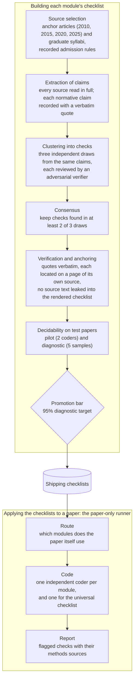

# How the AMICUS checklists were made

A key feature of AMICUS is the method-specific checklists: for each research
design or other feature relevant to the paper, we need a list of best practices that papers should follow, specified in a way that is easy to check systematically and rate. Of course, best practices are constantly evolving and debated, so deciding how to produce these lists is one of the most consequential choices for the system. This document specifies how those checklists are
produced and validated, with some diagnostics of how well the current system works, and notes on things that could be improved in the future. A short overview is in the
[README](../README.md); the public list of sources (citations and DOIs) is
[`METHOD_SOURCES.md`](METHOD_SOURCES.md).

## At a glance

- **What a check is.** One decidable test of a paper: when it applies (its scope), what a reader looks at, the condition for PASS and for FLAG, a severity, and the pages of the methods literature that support it (§4). Silence in the paper is itself a verdict; NA comes only from the scope gate.
- **What ships.** Fourteen method modules and 270 checks, between 9 and 62 checks per module (§6.4). One universal checklist of 28 checks applies to every paper (§2.5).
- **How sources were chosen.** For twelve of the fourteen modules, by fixed rules, not by hand. The frame is every research article published in 2010, 2015, 2020 and 2025 in eight political science and economics journals, plus the reading lists of graduate methods courses. A methods paper is admitted when at least two of the articles that use the method cite it, or when it appears on at least two graduate syllabi. The syllabus route is only partly in use (§2.2). A methods-journal fallback applies only to modules left with fewer than ten sources. For two modules, `measurement` and `hte`, a language model proposed the sources and the authors approved them (§2.3). The universal checklist has its own source route (§2.5).
- **How a checklist is built.** Language-model agents read every source in full and record each normative claim with a verbatim quote, cluster the claims into checks, and a separate adversarial agent re-reads the evidence. Mechanical gates reject any quote that is not verbatim, any evidence that cannot be located on a page of its own source, and any check that rests only on advice (§3, §5).
- **Three draws and a consensus.** A single clustering run is a draw from a distribution, so the claims are clustered three independent times and a check survives only if it appears in at least two of the three draws. The consensus is then re-measured from scratch (§6.3). All fourteen shipped modules are consensus artifacts (§6.3).
- **Decidability and the bar.** A checklist is decidable if independent coders reading the same paper reach the same verdict. It is measured on political-science test papers with two coders (pilot) and with five samples at nonzero temperature (diagnostic). Both numbers are reported for every method module. The 95% target applies to the diagnostic; three of the fourteen shipped modules meet it (§6.2, §6.4). The universal checklist has no test-paper pilot or diagnostic; its repeat-coding reliability is in §6.4.
- **Main limitations.** Agreement is not validity: a checklist can be decidable and still wrong. Reliability has a noise floor of roughly five to eight points on a fresh measurement. Eleven modules are under the target. The held-out coverage test has never been run. Many checks rest on a single source (§9).

**These checklists and the working paper.** This release ships the consensus checklists built from sources of every year in the frame, up to 2025. The working paper audits preprints posted from 2020 to 2022, so its analysis used the versions restricted to source papers published up to 2020. Those 2020 checklists have 242 checks across fifteen methods (the fifteenth, causal machine learning, is not in this release), and 175 medium- or high-consensus checks form the paper's main set. The counts and sources here therefore differ from the paper's appendix tables. The universal checklist is the same 28 checks in both.

## How the pieces fit

The mechanical gates of the verification step run on every draw as well as on the consensus. Sections 2 to 6 follow the top row in order; §8 describes the runner.

---

## Contents

1. [What we want from a checklist](#1-what-we-want-from-a-checklist)
2. [Source identification](#2-source-identification)
3. [The generation pipeline](#3-the-generation-pipeline-stage-by-stage)
4. [The checklist item schema](#4-the-checklist-item-schema)
5. [Gates and invariants](#5-gates-and-invariants)
6. [Validation and promotion](#6-validation-and-promotion)
7. [Development record](#7-development-record)
8. [Operating the pipeline](#8-operating-the-pipeline)
9. [Known limits and open questions](#9-known-limits-and-open-questions)
10. [Appendix A: source lists](#appendix-a-source-lists)
11. [Appendix B: version history](#appendix-b-version-history)

## 1. What we want from a checklist

One of the key purposes of the audit is to give authors advice grounded in the methods their paper uses. This advice will only be as good as the underlying checklists. What do we mean by "good"? Practically speaking, we want the checklists to best approximate the consensus of the current methodological literature. To ensure we are meeting that goal, we also have three more specific aims. The process to make the checklists and the checklists themselves should be **transparent**: every item should trace to the
specific passages in the methods literature that justify it. And, as we do in this document, all steps that produce it should be documented. Second, the process should be **neutral**: which items appear should follow from explicit rules applied to a corpus selected in advance, so that the checklist approximates the consensus of the literature and does not encode our (or people we could hypothetically ask to make checklists) tastes. And it should be **updatable**: when the literature changes, the checklist should be easy to regenerate with these updates.

At a high level, we accomplish this by (1) starting with a set of recently published papers (2) looking at the methodological papers they cite, and building on those "seeds" systematically, and (3) extracting the claims and advice from those papers, and then consolidating into a consensus checklist. 

**Where things stand.** The system covers fourteen research designs and other aspects of empirical methods (we call each a
*module*): instrumental variables, difference-in-differences, regression
discontinuity, conjoint, survey and field experiments, text-as-data, matching,
mediation, multilevel models, panel data, synthetic control, measurement, and heterogeneous treatment effects. For
each module, the pipeline identifies a set of sources describing how these designs and methods should be done, extracts every normative claim those sources make, and consolidates the claims into a checklist of between 9 and 62 items (270 in all). A fifteenth checklist, the universal checklist, has 28 items and applies to every paper (§2.5). Because independent runs of the consolidation step produce
checklists that broadly agree in substance while differing in wording and other secondary features, each production checklist is a *consensus* of three independent runs (§6.3). After producing the checklist, the reliability (whether independent reads of the same paper reach the same verdict) is measured on real political-science papers (§6.1).

---

## 2. Source identification

### 2.1 Criteria before candidates

First we must identify the set of sources from which the checklists are built. The procedure aims to identify papers that are high quality and influential, without any manual decisions about what to include. The selection criteria were written and fixed before any candidate was examined; the criteria document and the source-selection records are kept in the project's internal repository and are not part of this release.

### 2.2 The anchor design

We identify high-quality and influential methods papers through revealed citation and teaching behavior: the papers a field's publications cite when they use a method, and the papers its graduate methods courses assign, are collectively the methods literature that governs that method's practice.

The construction proceeds in four steps.

**Anchors.** The sampling frame starts from *anchors*: every substantive research
article published in final form in four sample years, 2010, 2015, 2020 and 2025, in eight
fixed journals, *APSR*, *AJPS*, and *JOP* in political science; *AER*, *Econometrica*,
*JPE*, *QJE*, and *REStud* in economics. (We do not include online-first and accepted
papers, as they do not yet have a final publication date.) These journals define publication
practice in the audit's target discipline and in the neighboring discipline that produces
most of its econometric methods.

**Method tagging.** Each anchor is classified by the research designs and methods it
uses, from a direct match of the method's name in its title or abstract, yielding, for every
module, its *method anchors*, the anchor articles that actually use that method.

**Candidates.** Every work an anchor cites is a candidate, and the records keep every
anchor-to-reference edge. The second source of candidates is teaching: the reading lists of
graduate courses in economics and political science departments, one list per distinct
course (its latest located version), with every listed work transcribed whatever its reading
status. The syllabi number 137 (82 in political science, 55 in economics). Under these rules there are no hand-picked additions.

**Admission.** A candidate enters a module's corpus only through one of three recorded
routes, and the admitting rule is recorded on the source's registry entry. A methods source
must also pass a methods-orientation classification; an applied work that meets a route is
admitted as an application exemplar and reported separately.

| Rule | Condition |
|---|---|
| `GENERAL_ANCHOR_CITED_BY_TWO` | cited by at least two distinct method anchors of the module |
| `APPLICATION_ANCHOR_CITED_BY_TWO` | an applied anchor cited by at least two other applied anchors of the module (application exemplar) |
| `REPEATED_GRAD_SYLLABUS` | on at least two distinct graduate syllabi, and relevant to the module |
| `REPEATED_SYLLABUS_APPLICATION` | as above, for an applied work (application exemplar) |
| `METHODS_JOURNAL_ABSTRACT_MATCH` | only when the first two routes leave a module with fewer than ten methods sources: an article in one of ten fixed methods journals whose abstract names the method, ranked by citations per year since publication, admitted until the module reaches ten |

Citation counts, recency, PageRank, co-citation and venue prestige admit nothing outside the
fallback's ranking. A retracted or bibliographically invalid candidate is excluded. A module
whose candidates meet no rule admits nothing, and thin corpora are reported as such. The
admitted registry for each module is frozen, one record per source with full citation, DOI
and the admitting rule.

The syllabus routes are only partly in use. They have admitted few sources. We have not yet sorted by method most works that are on two or more syllabi. Most works that would qualify only through teaching, textbook chapters in particular, are therefore not in the corpora.

### 2.3 Where each module's registry comes from

Every production checklist generates from its module's admitted registry, a frozen record (kept in the internal repository) of the criteria-locked selection above, carrying
full citation, DOI, inclusion rule, and metric provenance per source. Two cases sit
outside the standard route and say so on their records.

1. The anchor design did not find enough sources for `measurement`. A language model proposed its sources, and the authors approved them. The registry uses the same record conventions as the others. Its admission fields are empty, because the record must not claim a route it cannot evidence.
2. The same holds for `hte` (heterogeneous treatment effects). A language model proposed its sources, and the authors approved them. The anchor and syllabus rules did not admit them.

There is no module for ordinary least squares.

The admitted lists deliberately include **applied** works alongside methodological
ones, highly anchor-referenced applications of a method. Typing at generation time
classifies each source, and applied examples may only qualify checks, never establish
them: a practice becomes a requirement because the methods literature says so, and an
application can at most illustrate or soften it.

### 2.4 Artifact verification

Retrieval produces two kinds of wrong artifact frequently enough to require a systematic check before generation begins.

**The file must be the article of record.** In one audited corpus of 108 retrieved PDFs, 12 were supplements, online appendices, or supporting information, and only half of those were identifiable from their URLs, the title page is the only decisive evidence. This matters substantively: one source's supplement yielded 8 claims where its article yielded 73, understating an entire family of estimators. The audit stage therefore title-checks every PDF. A supplement is mined only as an acknowledged supplement (unacknowledged ones are marked automatically and the mis-binding recorded for re-retrieval), carries a mandatory yield caveat, and is cited as its own document with its own pagination.

**Citations are read off the title page** and reconciled against the registry's full citation and DOI. Derived short cites are lossy, "Andrews, Stock & Sun (2019)" becomes "Andrews (2019)", and a checklist whose evidence must be verifiable cannot cite from lossy fields. A module's sources must pass this title-page verification before generation starts.

### 2.5 The universal checklist

Some requirements apply whatever the research design. The universal checklist holds them. It has 28 checks and applies to every paper. We built it with the same steps as the method checklists (§3, §6.3). Two things differ: how its sources were chosen, and a final selection that shortens the list. Its check ids start with `UNIV-`.

**Sources.** The candidates are the 513 works that appear on at least two of the 137 graduate syllabi of §2.2. A language model read each work's title, its listings on the syllabi, and the section headings it appears under. It sorted the works into three groups. We told it to keep works that cover requirements that apply whatever the research design, and to drop works that cover requirements for one design only. It kept 31 works, marked 67 as borderline, and dropped 373. Of the 31 works, 15 are books. For these books we use only the chapters that a syllabus lists. Two books gave no checks, because no syllabus lists any of their chapters.

**Claims and checks.** We extract the normative claims as in §3. A rule sets aside the claims that apply to one method only (2,642 claims). That leaves 3,297 claims from the core sources. We divide them by topic into nine groups. Each group is clustered and verified three independent times, and a check stays if it appears in at least two of the three draws. A separate model call then compares checks from different groups in pairs, in both orders. A check must rest on requirement claims from at least two works. This gives 137 checks.

**Selection.** Many of the 137 checks overlap. The pairwise comparison judged no two checks to be the same. It judged 129 pairs to overlap or nest. Two mechanical steps give a shorter list. First, we group the checks that the comparison links as overlapping in both orders. Each group keeps the check that the most works support. This leaves 56 checks. Second, we keep a check only if at least three works support it. This leaves 28 checks. If we applied the three-work rule first, 35 checks would stay. No model reworded, merged or renumbered a check in these two steps.

The universal checklist has no consensus grade. Every check rests on at least three works. The shipped copy adds DOI links and the plain-words lines. The list of its sources is under "Sources" in `UNIVERSAL_CHECKLIST.md`. This release removes two cross-references to check ids from an interim list: one in the `nonexperimental_causal` definition, one in a pass condition. The checks themselves are unchanged. The working paper's coding used the list with the two cross-references.

---

## 3. The generation pipeline, stage by stage

Generation runs as eleven stages in fixed order, and the run cannot advance past a stage until that stage's gate passes. Mechanical stages are deterministic programs. Where a stage requires judgment, reading sources, drafting checks, adversarial review, it hands a fully-specified prompt to a language-model agent and validates the agent's output against machine-checked gates before proceeding. Every stage is resumable, so a stopped run continues from its last completed stage. The generation harness that drives these stages is not part of the public release; the stage prompts (`scripts/skillgen/prompts/`) and the column-aware extractor (`scripts/skillgen/extract_columns.py`) are.

### Stage 0, `audit` (mechanical, blocking)

For each configured source: open the PDF, read the first page, compare against the
registry. Detects (a) title pages matching
`supplement|supporting information|web appendix|online appendix`, and (b) two-column
body layout, by assigning text blocks on a body page to columns via bounding boxes.
Writes `typing/corpus_audit.json`.

**Blocks** if a PDF is missing or unreadable. A title page that reads as a supplement
without being acknowledged as one is marked automatically, the source is then mined
under a supplement's yield caveat and the mis-binding recorded for re-retrieval. This
is the batch-scale protection for §2.4.

### Stage 1, `extract` (mechanical)

Column-aware extraction for every source into `<run>/text/`, via
`scripts/skillgen/extract_columns.py`. This is the only text the miners read and the
only text quotes are gated against, so "verbatim" is well defined.

The algorithm takes PDF layout blocks; a block spanning > 60% of the text width is *full-width*
(title, abstract, wide table) and is kept whole; narrower blocks are assigned to a
column by their bounding-box centre; full-width blocks are emitted first, then left column,
then right, each top-to-bottom. Ligatures are folded, hyphenated line-breaks rejoined,
soft line-wraps unwrapped. Lines are prefixed `L<n>: ` and pages marked
`=== PDF PAGE n ===`.

The column-awareness matters because 46% of the corpus is two-column, and reading a two-column PDF straight across interleaves the columns. Quotes mined from interleaved text are spliced from two columns and fail the verbatim gate. A naive midline-clip approach fixes interleaving but decapitates full-width elements (titles, abstracts).

Then sources are greedy-packed by size into mining groups (~4 sources or ~300KB each).

### Stage 2, `mine` (agent, one per group), `prompts/mine.md`

Each agent reads its sources **in full** and extracts every normative claim: any
statement that a researcher should/must do something, that a practice is
invalid/biased/misleading, or that an assumption is required for a result to hold. A
claim that an estimator is inconsistent under stated conditions *is* normative.

**Clean-room rule (absolute).** No existing checklist, skill file, module skill, prior
claim ledger, or other generation run may be read. The checklist should reflect what these
papers say.

**The modal test.** Sources speak in two moods and each claim records which:

| `modality` | Signals |
|---|---|
| `requirement` | "must", "requires", "rests on", "is invalid unless", "is inconsistent when" |
| `advice` | "we recommend", "may choose", "there is little need for", "the best practice would be", "one strategy is" |

Advice is recorded, the ledger must be complete, but it cannot
establish a check. This matters because a "practical guide" paper's closing pages are
often a user checklist for the authors' own software, and that prose slides between
establishing an assumption and recommending a workflow. Of 9 checks proposed from one such practical guide (Liu, Wang & Xu's counterfactual-estimators guide), every survivor came from the assumption sections and every failure came from the workflow bullets.

Output: `claims/group<i>.jsonl`, one row per claim, `claim_id` (`<source_id>-C-NN`), `source_id`, `short_cite`, `source_lines`, `quote`
(verbatim, single contiguous passage), `claim_text` (own words), `strength`
(`establishes`/`qualifies`/`mentions`), `modality`, `source_type`, `scope_conditions`.

### Stage 3, `quotes` (mechanical, blocking)

Schema validity, enum validity, unique IDs, IDs carrying their `source_id`, and, the
point, **every quote verbatim** in the run's own extraction. Verbatim is checked
after Unicode and ligature normalization, and the matcher tolerates the two artifacts
PDF extraction genuinely produces: unreliable inter-word spacing (quotes are also
compared with whitespace removed) and page-boundary interpositions (a quote spanning a
page break is matched as ordered verbatim runs that step over the extractor's injected
page markers and running heads). Every character of a quote must still match the
source in order, so paraphrase and fabrication are rejected. Deterministic slips are
repaired in place and logged (a strength word mis-filed in the modality field, for
example); a claim with an unsalvageable defect is dropped with a logged reason rather
than blocking the run, and the stage hard-fails only if drops exceed 15% of the
ledger, which indicates a systemically wrong input rather than isolated slips. Merges
groups into `claims/<mod>.jsonl`.

### Stage 4, `cluster` (agent, exactly one), `prompts/cluster.md`

Claims → proposed checklist. Rules:

1. **Narrowest first.** Propose specific checks before broad ones; broad checks must not
   swallow claims stating a narrower, distinct requirement. (First-match ordering once
   let broad checks absorb narrow ones and left three checks empty, hence two-pass.)
2. **One claim, one home.** Every claim → exactly one check or one `PARK:<reason>`. No
   claim on two checks; none silently dropped.
3. **Modality governs.** A check may be *established* only by `requirement` claims;
   advice may qualify, or is parked.
4. **A check is decidable from what a paper records, not from what its author did.** If
   the observable is the analyst's process (an order of operations), it is not a check.
5. **`meta_research`** (reviews/audits of practice) may establish only REPORT/ROBUST
   checks and carry prevalence aggravators; elsewhere it may only qualify.
   `applied_example` may only qualify.
6. **Park reasons**: `implementation_detail`, `motivation_only`, `workflow_advice`,
   `new_check_candidate` (real requirement, insufficient grounding), `duplicate`.

Outputs `checklists/proposed.json` (header object first) and
`checklists/assignments_proposed.jsonl`.

### Stage 5, `verify` (agent, exactly one, must not be the cluster agent), `prompts/verify.md`

An independent adversarial pass that reviews the proposed checklist for errors in reading the sources. Per-check verdicts are KEPT / REWORDED /
MERGED-INTO / DISSOLVED, defaulting to merging when in doubt. It must:

1. **Check the reading.** Re-read every evidence quote **in its source context**. A
   verbatim, correctly-cited quote can still be misread into a wrong requirement, and
   no mechanical check catches this. Overstated requirements ("must" where the source says
   "may"; general where the source is conditional) are rewritten down or parked.
2. **Check modality**, dissolve checks resting only on advice; catch process-observables.
3. **Merge redundancy**, default to merging; checklist inflation is the failure mode.
4. **Check membership**, every claim genuinely establishes/qualifies its target.
5. **Check decidability**, could two independent coders agree? Sharpen or park.
6. **Enforce schema law** so downstream gates pass.

Outputs the **final** `checklists/verified.json`, `assignments_final.jsonl`, and
`cluster_review/verification.md` (per-check verdicts + an inference-leaps section).

### Stage 6, `validate` (mechanical, blocking)

The written invariants, see [§5](#5-gates-and-invariants).

### Stage 7, `anchor` (mechanical, blocking)

Locates each evidence quote's **PDF page**, then translates to **printed folios**.

- *Page location*: per page, token-overlap score against a column-aware page
  representation (full page text + left column + right column concatenated, since
  matching only asks "is this text on this page"). ≥ 0.90 = strong; 0.70–0.90 with an
  adjacent runner-up = page-straddling. Fallback for PDFs whose fonts carry no space
  glyphs (words glue together, defeating token matching, as in older JSTOR scans):
  match on the despaced character stream.
- *Folio recovery*: read margin numbers (top/bottom 72pt); accept an offset only if it
  is consistent across ≥ 3 pages **and** maps the PDF onto the citation's recorded
  printed range. Running heads ("Journal of Econometrics 190 (2016) 212-221") and JSTOR
  download stamps salt the margins with numbers, an unvalidated vote once produced
  "page −8". If no folio survives, PDF pages are cited and labeled as such.
- *`further_reading`*: per check, from its own evidence, cite + page range per
  contributing source. The range is where that check's support sits, so the reader is pointed directly to the relevant passages.

**Blocks** on any unanchored row (non-verbatim vs the PDF, or wrong source file).

### Stage 8, `render` (mechanical)

`checklists/<MOD>_CHECKLIST.md`: verdict semantics, the evidence-scope rule, the
thresholds-are-rules-of-thumb note, scope-trigger definitions, then checks by category
with pass/flag/silence, thresholds, author guidance, and further reading; then the
source list. **No quotes.**

### Stage 9, `leak` (mechanical, blocking)

No 8+ token window of any evidence quote may appear in the rendered markdown. The typical case is a check's own `requirement_statement` having absorbed source prose (caught live twice: one check absorbed 10 words of Andrews, Stock & Sun 2019; another absorbed a phrase from Liu, Wang & Xu).

### Stage 10, `report` (mechanical)

`gaps/<mod>.md`: parked claims by reason, empty categories, zero-yield sources,
supplement caveats, and the **single-source-check rate**, a corpus-health metric (each
such check is one misreading or retraction from being wrong).

`MANIFEST.json`: module, instruction version, pinned model, per-source PDF SHA-256 with
claim yield and type, check counts, checklist hash, and the promotion block (status +
reason). "Which law was this built under?" is unanswerable retroactively and free
prospectively. The check counts, category counts, single-source count and the SHA-256 of `checklists/verified.anchored.json` were written before the consensus and anchoring steps. For the shipped runs they were recomputed from the shipped artifact on 20 November 2026 (`scripts/skillgen/refresh_manifest_fields.py`), and the earlier values are kept under `previous_descriptive`.

---

## 4. The checklist item schema

| Field | Meaning |
|---|---|
| `check_id` | `<MOD>-<CAT>-NN` |
| `category` | `IDENT` · `EST` · `INFER` · `ROBUST` · `REPORT` · `DATA` |
| `scope` | list of triggers; the check applies only if **all** fire |
| `claim` | what the sources assert (our words) |
| `observable` | what a coder looks at |
| `pass_condition` / `flag_condition` | decidable conditions |
| `verdict_when_silent` | `FLAG` or `PASS`, **never NA** |
| `severity_if_flagged` | `HIGH` · `MEDIUM` · `LOW` |
| `severity_basis` | traceable to a source |
| `prevalence_aggravator` | optional; meta-research evidence that the error is common |
| `threshold` | `{cutoff, border_band, provenance}` or null |
| `coder_decidable` | must be `true` (undecidables are parked, not shipped) |
| `requirement_statement` | one sentence, our words |
| `contributing_sources` | short cites |
| `evidence[]` | `{source_id, short_cite, source_lines, quote, support_relation}` |
| `clarity_check` / `author_guidance` | for author-facing clarity checks |

### 4.1 Scope triggers

Decidable yes/no questions about a paper's design, keyed on the paper's **own explicit
stance**, defaulting **OUT** on silence, each defined in the header's
`_scope_definitions`. Example (DiD `staggered`): "Does treatment adoption occur at
different times across units, i.e. the paper reports two or more distinct adoption
dates/cohorts? Default OUT if the paper states a single common adoption date, or does
not state adoption dates at all (DID-REPORT-02 flags that silence)."

Sharpening a trigger is the usual response to a decidability wobble. IV's `late` trigger
originally fired on any heterogeneity discussion and produced a 3/2 coin-flip across
samples; sharpened to require the paper's own explicit LATE/complier/monotonicity
interpretation, it went unanimous.

### 4.2 Silence resolution

`verdict_when_silent` is `FLAG` for positive requirements ("the paper must state X") and
`PASS` for absence-of-misuse ("the paper must not do Y", silence means it didn't).

**Never NA.** NA is the scope gate's job alone. A silence-NA duplicates the gate and
makes `flag_condition` unreachable, disarming a check in the exact case it
exists for. In an early difference-in-differences build, 22 of 60 checks had this pattern; on a
staggered-adoption test paper it sent a treatment-reversal check to NA although the
paper explicitly described on-off switching with no carryover discussion. Regeneration found all 22 were pure redundancy.

### 4.3 Clarity checks

Where defaulting a trigger OUT would bury a finding, the solution is an
author-facing `all`-scope check that flags the silence, with `author_guidance` saying
what to state. This improves both decidability (the wobble disappears) and informativeness, the ambiguity becomes an explicit, constructive finding.

### 4.4 Thresholds

Explicit `cutoff`, a `border_band` for near-threshold values, and `provenance`:
`theoretical` (derived), `conservative_bound`, or `rule_of_thumb` (conventional). A
verdict may never rest on a vague quantifier ("small", "weak", "adequate"). Borderline
values are reported as borderline rather than silently rounded, the flag records
closeness without changing the verdict, so the report can say "rests on a first stage
that just missed the conservative cutoff" while the verdict stays reproducible.

### 4.5 Evidence-scope rule (applying a checklist)

An audit judges only the text it has. Required material absent from the available
text is flagged, with `may_exist_elsewhere: true` and commentary naming the pointer
("may be addressed in Appendix F, which this audit could not access"). The verdict is
never NA (which hides the finding from the report) or PASS (which is unfounded). Every
audit declares its evidence scope: main text only / + appendix / + replication package.

---

## 5. Gates and invariants

Blocking, in stage order:

| Gate | Enforces |
|---|---|
| `audit` | every source's artifact is the document the registry claims (supplements acknowledged) |
| `quotes` | claim schema + enums + unique IDs; **every quote verbatim** in the run's extraction |
| `validate` | category ∈ taxonomy · scope non-empty and every trigger defined · `verdict_when_silent ∈ {FLAG, PASS}` · severity ∈ {HIGH, MEDIUM, LOW} with a `severity_basis` · `coder_decidable = true` · required prose fields present · evidence present and verbatim · `meta_research` establishes only REPORT/ROBUST · every claim assigned exactly once · **no check rests only on advice-modality claims** |
| `anchor` | every evidence row resolves to a real page in its own PDF |
| `leak` | no 8+ word verbatim source run in the rendered artifact |

Each of these gates addresses a failure that occurred in practice; they are enforced mechanically so that no stage can be skipped.

---

## 6. Validation and promotion

### 6.1 Coder-decidability protocol

Decidability means that independent coders, reading the same paper with the same checklist,
produce the same categorical verdict. Free-text rationale is never scored; the
verdict/commentary split means prose may vary run-to-run while the verdict should not.

Procedure: N ≥ 2 coders per paper, no
shared state, inputs limited to the rendered checklist and the paper text. Coders record
`{check_id, in_scope, triggers_fired, verdict, borderline, may_exist_elsewhere, note}`
for every check. Per-paper and pooled agreement are computed from the codings, and disagreements are dissected check by check. The coder prompt is `scripts/skillgen/prompts/coder.md`, and each shipping method module's `MANIFEST.json` records its topline reliability counts (§6.4).

Two instruments run per module, and their names recur throughout: the **pilot** (two independent coders per test paper) and the **diagnostic** (five independent codings of each paper at sampling temperature). The diagnostic exists because two coders can agree by luck: one test paper rated 35/36 under two coders but only 30/36 across five samples, the two coders having landed in the same camp of what was really a 3/2 coin-flip. The diagnostic is the checklist-vetting instrument. Production audits run at the coding agent's default settings, not at temperature zero, so a recoded text can get different verdicts: in the working paper's repeat coding of identical text, 7.8% of flags became passes and 5.1% of passes became flags (1,204 texts).

Test papers are recent, open-access political-science articles, the audit's target
discipline, one to five per module, chosen to exercise the design the module
covers. This release does not name them.

### 6.2 Promotion gate

A checklist is `NOT_PROMOTABLE` until decidability is measured. Criteria:

- coder-decidability measured on political-science test papers, with the N ≥ 3 temp>0 diagnostic;
- zero unanchored evidence rows; zero silent-NA; zero leaks (mechanical, enforced);
- held-out coverage ≥ 70% severity-weighted (**specified but never yet run**; see §9);
- the gap report's caveats (supplement yields, single-source rate, empty categories)
  reviewed.

The reliability target is 95% core stability on the diagnostic. It is a calibration target, not a hard filter: promotion review weighs the measured consensus numbers directly, and eleven shipped modules are below it (§6.4). The modules below the target ship under this provisional bar.

### 6.3 Draw variance and the consensus ensemble

A single run of the consolidation stage is a draw from a distribution. Re-clustering
the identical mined claims under identical rules produces checklists that agree in
substance while differing in wording, item granularity, and emphasis, and those
surface differences move measured reliability by ten points or more between draws of
the same module (across three draws each: 77.8–100% for difference-in-differences,
85.5–90.3% for regression discontinuity, 87.5–96.2% for multilevel). This has two
consequences. A single draw's score conflates checklist quality with draw luck, so
comparisons between versions of the generation rules based on one draw each are
uninformative, re-running the full set under revised rules reproduced textbook
regression to the mean, with previously weak modules improving and previously lucky ones
declining. And any single shipped draw may simply be a bad draw.

The production method is therefore an ensemble. Each module's ledger of mined claims
is clustered three independent times; checks are aligned across the three draws by
text similarity, with at most one variant per draw per concept; concepts appearing in
at least two of three draws are kept, keeping one draw's wording where the draws word a kept concept differently; and the resulting consensus checklist receives a fresh
confirmation pilot and diagnostic, measured with no selection on the test papers.
Consensus selects among independently generated checks and never edits their content,
so the clean-room property is preserved.

We ran the consensus program on all twelve corpus modules. `measurement` and `hte`, generated later, used the consensus recipe from the start. All fourteen shipped modules are therefore consensus artifacts. For difference-in-differences, multilevel and conjoint, consensus raised the diagnostic substantially (difference-in-differences 81→100, multilevel 84→97.5, conjoint 95→100). Eight modules (`mediation`, `survey_exp`, `synth`, `text`, `iv`, `matching`, `panel` and `field_exp`) also had an earlier single-draw artifact built from the same corpora. On the five-coding diagnostic, the consensus artifact scored 0.1 to 11.8 points lower than the single draw for all eight. On the pilot, it scored equal or higher for six. Differences of five to eight points are within the noise of a single measurement (§9). Each module's figures are in §6.4. One comparability caveat: the
measurement module's generation ran on a newer model than the pinned one, so its
numbers are not directly comparable with the other thirteen.

**The remaining instability.** Two experiments tested whether the instability that survives the ensemble can be reduced through checklist edits. Redrafting the nine least stable measurement checks under sharpened scope rules moved that module's consensus diagnostic from 85.5% to 86.3%: the redrafted checks improved, but untouched checks slipped by almost exactly the same amount, the module sits at an 86% ± 3 floor across all six of its measurements. Retrofitting concrete verdict bars onto the least stable regression-discontinuity checks made that module worse (85.5% to 75.4%), because bars concretized after the fact bind at different points than a coder's reading of borderline papers. The residual appears to be instrument noise plus genuinely borderline paper-check pairs, and it grows with checklist length, the modules furthest below the target are among the largest (62 and 23 checks). The 95% reliability figure accordingly serves as a calibration target, with promotion review weighing the measured consensus numbers directly. The open question is on the instrument side: more samples or papers per module to shrink the ±5–8 point noise on a fresh measurement, or scoring at the level of the judgment-call buckets the diagnostic reports already track.

**Provisional bar.** Because that content lever is exhausted, the 95% figure stands as the calibration target. Eleven modules are below it, the lowest being `measurement` and `rdd` at 85.5%. These modules ship under a provisional bar that promotion review revisits as the instrument improves.

### 6.4 The shipping set

Every module ships its consensus artifact (§6.3). Each reliability cell reads: test papers × codings per paper, paper-check pairs with the same verdict in every coding out of all pairs, and the percentage. The diagnostic has five codings per paper. The pilot has two. The figures are the topline counts in each module's `MANIFEST.json`. A paper-check pair counts as stable if every coding of that paper gives the check the same verdict. Every check of the module is counted.

| Module | Checks | Diagnostic | Pilot |
|---|---|---|---|
| `iv` | 13 | 3 × 5, 34/39, 87.2% | 4 × 2, 51/52, 98.1% |
| `did` | 16 | 1 × 5, 16/16, 100.0% | 1 × 2, 16/16, 100.0% |
| `rdd` | 23 | 3 × 5, 59/69, 85.5% | 3 × 2, 64/69, 92.8% |
| `conjoint` | 14 | 3 × 5, 42/42, 100.0% | 3 × 2, 42/42, 100.0% |
| `survey_exp` | 24 | 2 × 5, 43/48, 89.6% | 2 × 2, 45/48, 93.8% |
| `field_exp` | 23 | 4 × 5, 85/92, 92.4% | 4 × 2, 91/92, 98.9% |
| `text` | 17 | 2 × 5, 30/34, 88.2% | 2 × 2, 34/34, 100.0% |
| `matching` | 12 | 4 × 5, 44/48, 91.7% | 4 × 2, 46/48, 95.8% |
| `mediation` | 12 | 3 × 5, 33/36, 91.7% | 3 × 2, 36/36, 100.0% |
| `multilevel` | 10 | 4 × 5, 39/40, 97.5% | 4 × 2, 39/40, 97.5% |
| `panel` | 11 | 4 × 5, 41/44, 93.2% | 4 × 2, 44/44, 100.0% |
| `synth` | 9 | 3 × 5, 25/27, 92.6% | 3 × 2, 27/27, 100.0% |
| `measurement` | 62 | 4 × 5, 212/248, 85.5% | 4 × 2, 230/248, 92.7% |
| `hte` | 24 | 5 × 5, 113/120, 94.2% | 5 × 2, 115/120, 95.8% |

The counts sum to 270. The 95% target applies to the diagnostic. Three of the fourteen modules meet it (`conjoint`, `did`, `multilevel`). The other eleven range from 85.5% to 94.2%. The lowest are `rdd` and `measurement`, both at 85.5%. The pilot is reported alongside. Three modules are below 95% on it: `rdd` (92.8%), `measurement` (92.7%) and `survey_exp` (93.8%). Across all fourteen modules, the test papers give 816 stable pairs out of 903 on the diagnostic (90.4%) and 880 out of 916 on the pilot (96.1%). The `measurement` module is 27% of these pooled pairs. The universal checklist is not in this table, because we ran no pilot or diagnostic on test papers for it.

**Repeat coding in the working paper.** The paper measures reliability a second way, on its whole main sample. Every text was coded twice, on identical blinded text with the same model, instrument and assigned checklists, the universal checklist included. The importance-weighted overall score correlates at r = 0.87 across the two codings of 797 preprints and at r = 0.85 across 406 published versions. The universal score alone correlates at r = 0.84 on 798 preprints and on 406 published versions. At the level of a single check on identical text, 7.8% of flags became passes and 5.1% of passes became flags across 1,204 texts.

---

## 7. Development record

This section records the measurements that produced the rules described above. Current per-module figures are in §6.4; a first-time reader can skip to §8.

### 7.1 Generated modules

| | IV (v0.10, orchestrated) | DiD (v0.7 + LWX re-mine) |
|---|---|---|
| sources | 17 | 15 (+ 1 supplement as its own document) |
| claims | **366** (238 requirement / 128 advice) | 159 → +73 (LWX re-mine) |
| checks | **28**, IDENT 10, EST 4, INFER 4, ROBUST 3, REPORT 5, DATA 2 | **64**, IDENT 17, EST 16, INFER 7, ROBUST 16, REPORT 7, DATA 1 |
| parked | 58 (49 implementation detail, 5 motivation, 4 workflow advice) | 19 |
| evidence rows | 73, **100% anchored** | 203, **100% anchored** |
| scope triggers | 11 | 32 |
| single-source checks | 9/28 (32%) | 35/64 (55%) |
| decidability | **97.3%** (109/112, 4 papers × 2 coders) | 82% → 95% (one DiD test paper, 60-check version) |

### 7.2 The decidability arc

Each rule was introduced in response to a measured disagreement:

| Version | Rule added | Result |
|---|---|---|
| v0.1 | baseline | 83% (1 paper) |
| v0.2 | scope triggers + silence resolution | 98% (5 papers) |
| v0.3 | explicit thresholds + border band + provenance | 99% (5) |
| v0.4 | `conditional` trigger keys on the paper's own argument | 99% (3) |
| v0.5 | `late` trigger sharpened + clarity checks | one IV test paper 30→37/38 (5-sample) |
| v0.10 | clean-room regeneration under the full ruleset | **97.3%** (4 papers × 2 coders); 90.5% five-sample |
| v0.11 | six rules from the diagnostic; regeneration | IV **97.6%** pilot / **96.8%** five-sample; DiD **95.2%/95.2%** clean-room |
| v0.12 | four condition sharpenings from the re-measurement | applied; re-measurement queued |
| v0.10 + 5-sample diagnostic | (measurement, not a rule change) | **90.5%** per-verdict stability (3 papers × 5 samples) |

The v0.10 figure is notable: it is a checklist generated fresh under the clean-room rule, without access to the v0.2–v0.5 sharpenings, and it reproduces ~97% agreement from the sources alone. Two specific confirmations that the sources force the same distinctions: both coders of one IV test paper fired `multiple_instruments` at the design level via the same argument, and both coders of another IV test paper reached identical NA counts at the `heterogeneous_effects` boundary that caused the v0.4 wobble.

### 7.3 Findings during development

- **Pre-trends.** The DiD generation produced 60 checks and contradicted an earlier version's pre-trends guidance (the earlier version said "test pre-trends and proceed"; the source corpus says pre-trend tests are underpowered, distorted by conditioning on the pretest, and invalid under staggered heterogeneity).
- **11% of the corpus was the wrong document** (§2.4).
- **Extraction quality.** IV regeneration on column-aware text raised the claim count from 122 to 366, with every source's yield up 2–5× (Kolesár 6 → 32). Requirement-modality claims alone (238) nearly doubled the old total, so this was missed normative content rather than advice inflation.
- **The adversarial pass.** On DiD it reduced 9 proposals to 4 and turned one refutation into a bug fix (`DID-IDENT-09` did not flag a paper that tested for carryover, rejected, and proceeded, because it had tested). On IV it found 3 inference leaps, the most significant being `IV-DATA-01`: Abadie states covariate-support overlap is *implied by* the identifying assumption, and the proposal had inflated that into an affirmative duty to test overlap with FLAG-on-silence.

### 7.4 Live instabilities (IV v0.10)

The 5-sample temp>0 diagnostic (3 papers × 5 samples, harness-default temperature)
measured **76/84 = 90.5%** per-verdict stability against the pilot's 97.3% pairwise, confirming the protocol's premise that two coders can agree by luck. All three pilot
disagreement sites reproduced as wobbles, and five more surfaced that pairwise
agreement had masked, the largest being a **scope wobble on the
`heterogeneous_effects` trigger** (4 IN / 1 OUT on one IV test paper, flipping
IV-IDENT-05/07 between FLAG and NA). That is the v0.4 `late` pattern reproducing on
the successor trigger: the clean-room generation did not rediscover v0.5's sharpened
wording, though it did independently generate the accompanying clarity check
(IV-REPORT-06), so the v0.5 fix pattern applies directly. Other identified fix
targets: IV-EST-02 is an absence-of-misuse check wrongly carrying FLAG-when-silent
(one sample read the default as forcing FLAG when the flag scenario was merely
absent); IV-INFER-01 needs an explicit decision rule inside the borderline band;
IV-REPORT-01 must say which conjunct an appendix pointer bites. IV-IDENT-03 split 3/2, a genuine judgment call, possibly irreducible, best handled by a mandatory
borderline flag.

The pilot's three disagreements, each a distinct species:

- `IV-REPORT-01`, **not** a wording bug but an evidence-scope split: the paper reports
  F in the main text and defers first-stage estimates to the appendix; the check
  requires strength "together with the first-stage/reduced-form estimates". One coder
  applied the evidence-scope rule (→ FLAG), the other passed on the statistic. The check
  should say which conjunct the appendix pointer bites.
- `IV-IDENT-03`, a genuine judgment split on whether a timing-based exogeneity defense
  suffices against persistent confounders. Possibly irreducible.
- `IV-EST-02`, the "instruments used separately" seam: v0.4's residual edge (then
  `IV-IDENT-08`), resurfaced independently in a clean-room generation, flagged borderline
  by both coders. Structural.

Also surfaced without costing agreement: `IV-ROBUST-03`'s conditional phrasing ("when it
invokes an overidentification test") sits awkwardly with FLAG-when-silent on an
overidentified paper running no test; and in a second IV test paper, the same silence about standard
errors defaults `nonhomoskedastic` OUT (REPORT-05 → NA) while producing a FLAG on
INFER-03 via `all`.

---

## 8. Operating the pipeline

**Generating a checklist.** The generation harness is an internal tool; this section describes what it does. Generation agents are pinned to `claude-opus-4-8`, except `measurement`, which ran on `claude-opus-5`, and the universal checklist, which ran on `claude-opus-5-5`. The recipe of §6.3, end to end:

1. Build the run configuration from the module's frozen source registry.
2. Drive every stage of §3 headlessly: agents are spawned, gated, retried and killed on a wall-clock timeout if they hang. Mining groups run in parallel; `cluster` and `verify` are one agent each, and `verify` is never the cluster agent.
3. Produce draws 2 and 3 by rolling the run back to the `quotes` stage and re-clustering the same mined ledger.
4. Build the consensus from the three draws, then run it through the same stages and measure it afresh.

Agent failures ("Connection closed mid-response") are common at this scale. The runner should be checked on disk before re-running, since agents that fail mid-response often still write valid output. Only genuinely missing outputs need a re-run; the runner re-validates everything present.

**Artifacts per run.** `checklists/verified.anchored.json` (artifact of record) ·
`checklists/<MOD>_CHECKLIST.md` (rendered, cite-only; each check also shows its "In plain words" and "Why it matters" lines) · `checklists/explainers.json` (per check, a plain-language `plain`, `why` and `done` written by `scripts/skillgen/build_explainers.py`; the lines are for the report's reader, so the runner hands coders the checklist without them) · `checklists/dispute.json` (per check, whether an attached claim argues the practice is unnecessary or counterproductive) · `claims/<mod>.jsonl` (full
ledger) · `checklists/assignments_final.jsonl` (every claim's disposition) ·
`cluster_review/verification.md` · `typing/corpus_audit.json` · `gaps/<mod>.md` ·
`MANIFEST.json` · `decidability/` (procedure, codings, report). For each method module, the public release includes the rendered checklist, the artifact of record, the explainers file, the dispute file, and the run's manifest with its topline reliability counts; the rest stays in the internal repository. The universal run ships its rendered checklist, the artifact of record and the explainers file, and has no manifest or dispute file.

**Applying a checklist.** The public runner is `scripts/skillgen/paper_only_audit.py`. It works on a paper's text alone and has three steps. *Route*: one model call decides which modules' methods the paper itself uses in its own analysis. *Code*: one independent coder per routed module works through that module's checklist with the same coder protocol that every decidability measurement used. One more coder works through the universal checklist, which applies to every paper. *Report*: an author-facing markdown report lists the flagged checks, each with the methods literature behind it. Because every shipped check's observable is defined on the paper text, and silence is itself a verdict, no replication materials are needed; a FLAG means the paper does not report the practice. The README gives usage.

---

## 9. Known limits and open questions

1. **Held-out coverage has never run.** It is specified as a blocking 70%
   severity-weighted gate and has not executed once for any module.
2. **The taxonomy held.** Written when the schema had only IV and DiD behind it; the
   batch has since run it across every module, construct-validity and text-as-data
   modules included, and no module required a new category.
3. **The ROBUST contraction is unexplained.** IV went from 11 ROBUST checks (v0.5) to 3
   The likely cause is the modal test parking advice-derived robustness prose
   ("should probe robustness to..."), which is the designed behavior, but whether it is
   consolidation or over-strictness is unresolved. If too blunt, the fix is a rule
   refinement (e.g. well-corroborated advice establishing ROBUST checks at LOW severity),
   not a rollback.
4. **Single-sourcing is unmeasured as a risk.** In the development builds, 55% of DiD checks and 32% of IV checks
   rested on one source. It is reported in each gap report and the site's checklist page marks single-source checks as low consensus, but nothing in the pipeline drops or down-weights them.
5. **Shared sources across modules are undecided.** Some sources belong to two
   registries (a counterfactual-estimators guide sits in both the
   difference-in-differences and panel corpora). Mining shared sources independently
   per module pays twice and risks divergent claims and near-duplicate checks with
   different thresholds. Decide before the batch, not on module 9.
6. **The inference-leap gate is a single agent.** The mechanical gates check that quotes are verbatim and correctly paged, but only the adversarial pass checks that the *reading* is right. It should not be trimmed for cost.
7. **One closed-access supplement is outstanding** (Wang, Jiang, Zhang & Small, *Biometrics* 74(4), IV corpus): closed, not on arXiv or PMC, no author copy. It needs an institutional login to retrieve.
8. **Resolved:** `synth` generated from ten admitted sources under the anchor-pilot registries.
9. **The reliability instrument has a noise floor.** Fresh diagnostics of the same
   artifact vary ±5-8 points, and instability tends to grow with checklist size:
   `measurement` and `rdd`, the two modules furthest under the 95% target, have 62 and 23
   checks. Smaller modules are also under the target (`iv`, 13 checks, 87.2%; `text`, 17 checks, 88.2%), so size is not the only cause. Content
   remediation was tried and measured (§6.3): rewording the least stable checks
   relocated the instability (measurement 85.5→86.3, targets improved while untouched
   checks slipped by the same amount), and retrofitted concrete verdict bars made rdd
   worse (85.5→75.4). The bar is provisional; the open design question is
   instrument-side: more samples or papers per module, or scoring at the
   judgment-call-bucket level the diagnostic reports already track.
10. **Two model caveats.** Measurement's draws and confirmation ran at `claude-opus-5`, and the universal checklist ran at `claude-opus-5-5`;
   every other module is on the `claude-opus-4-8` pin. The promotion bar is the same for every module,
   so only cross-module comparisons of these numbers carry the asterisk.
11. **The universal checklist has no pilot or diagnostic.** We ran none on test papers. It has no consensus grade either. Each check rests on at least three works. Its only agreement measure is the paper's repeat coding (§6.4): r = 0.84 for the universal score on 798 preprints and on 406 published versions.
12. **The syllabus route is only partly in use** (§2.2). Textbook chapters in particular are missing from most corpora.

---

---

## Appendix A: source lists

[`METHOD_SOURCES.md`](METHOD_SOURCES.md) is the public list of sources, with full citations, DOIs and the rule that admitted each, for every shipped module. Every shipped check also carries its own evidence rows, each with a short citation and the pages of the source that support it, in the module's `checklists/verified.anchored.json`. The full admission records are kept in the project's internal repository.

---

---

## Appendix B: version history

The generation rules carry version numbers (`v0.x`), recorded in every run's manifest
so any artifact can be traced to the exact ruleset that produced it. Each version adds a
rule introduced in response to a specific observed failure. Full changelog with
evidence is kept in the internal repository.

| Version | Rule | Forced by |
|---|---|---|
| v0.1 | two-pass clustering, narrowest-first | broad checks swallowed narrow ones; 3 checks left empty |
| v0.2 | scope triggers + silence resolution | scope and silence were the dominant disagreement modes (83%) |
| v0.3 | explicit thresholds + border band + provenance | every threshold split; a blanket FLAG had a verdict wrong |
| v0.4 | `conditional` keys on the paper's own validity argument | an IV test paper: covariates doing double duty (efficiency vs identification) |
| v0.5 | `late` sharpened; scope ambiguity → clarity checks | 5-sample diagnostic found a 3/2 coin-flip cascading into 5 checks |
| v0.6 | corpus corrections classified and gated | the source-audit step is the only one that reads artifacts closely |
| v0.7 | `verdict_when_silent` never NA; evidence-scope rule | 22/60 DiD checks silently disarmed; appendix pointers |
| v0.8 | cite from `full_citation`+DOI; page locators; cite-don't-quote | lossy `short_cite`; line offsets aren't citations |
| v0.9 | column-aware extraction; validated folios; own-words prose | spliced quotes; "page −8"; a 10-word verbatim run leaked |
| v0.10 | modal test at mining time; process-observables are not checks; adversarial verification is load-bearing; one work can be two documents | 5 of 9 proposals refuted, all from workflow bullets |
| v0.11 | declaration-keyed triggers with named near-misses; five further construction rules + one accounting rule | first temp>0 diagnostic: 97.3% pairwise masked 90.5% five-sample stability (8 wobbly cells) |
| v0.12 | four condition-drafting refinements for cluster/verify | v0.11 IV re-measurement (97.6%/96.8%) |
| v0.13 | adjacency never fires a trigger, ambiguity resolves NA; evidence location immaterial | NA-vs-FLAG coin flips + appendix-evidence splits dominated four modules' diagnostics |
| v0.14 | concept_key; deterministic category order; granularity discipline | IV reproducibility experiment: 85% concept coverage but drifting IDs/categories (category fix adopted; free-form keys failed at 15% match) |
| v0.15 | scope-trigger definitions are crisp paper-observable self-description tests; verdict bars concrete and countable | declared-but-vague triggers and degree-word bars in the three production modules then below the bar |
| consensus | 3 same-ledger cluster draws → ≥2-of-3 concept consensus → fresh confirmation diagnostic (§6.3) | measured draw variance (±10-22 pts) dominates every rule effect; single draws are unreliable |
